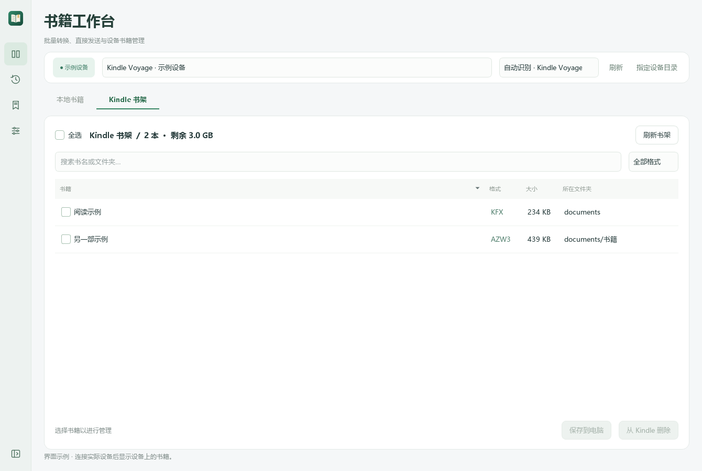
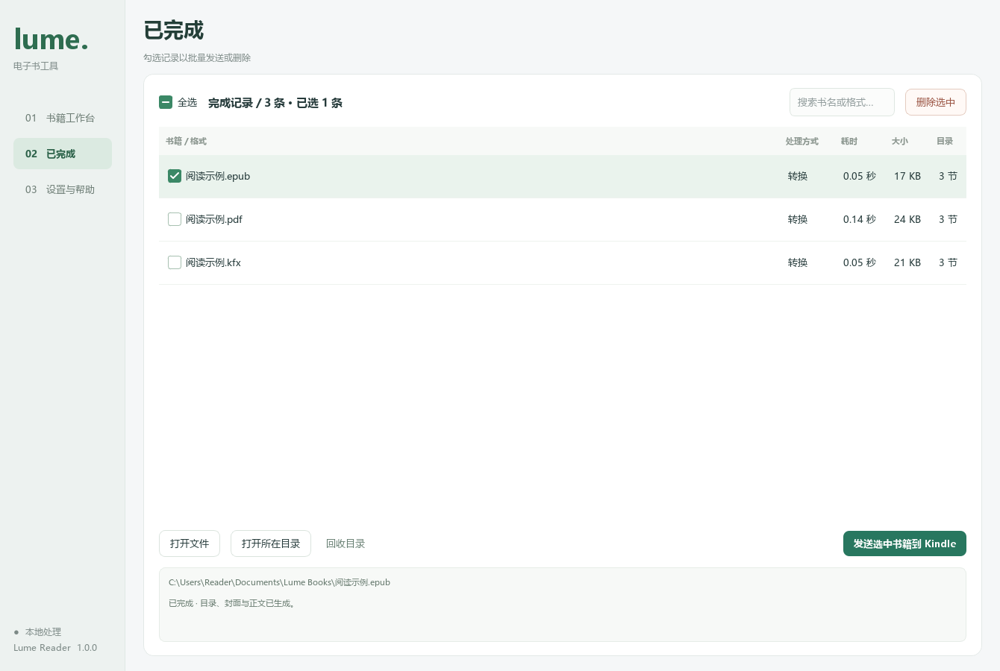

# 轻阅 · Lume Reader

Windows 电子书转换与 Kindle 书架管理工具，使用 Python / PyQt6 开发。支持批量转换、字体与封面设置、USB / MTP 有线传输，运行时不调用 Calibre。

[下载 Windows 安装包](https://github.com/jiuduweiliangeer/LumeReader/releases/latest) · [完整使用说明](docs/USAGE.md) · [构建安装包](docs/BUILD.md) · [开源协议](LICENSE.md)

## 安装与功能介绍

- Windows 10 / 11，64 位。下载 Release 中的 `LumeReader-1.0.0-Setup-x64.exe` 并运行。
- 安装包已包含 Python、PyQt6 和转换所需的开源组件，**不用安装 Python、Calibre 或 Calibre 插件**。
- **TXT、EPUB、KFX、PDF、HTML、FB2 之间互转，安装本软件即可使用。**
- **MOBI / AZW / AZW3 导入后转为上述六种格式，也不需要 KindleGen。**
- **只有导出 MOBI / AZW3 需要额外提供 KindleGen**，详见下面的表格和官方下载链接。
- Kindle Previewer 是可选的桌面预览工具；KFX 转换本身不依赖它。

当前安装包未做代码签名。Release 同时提供 `SHA256SUMS.txt`，可使用 PowerShell 的 `Get-FileHash` 核对文件。

## 格式与额外依赖

“直接使用”指已经安装 Lume Reader。转换依赖由**目标格式**决定；原文件必须未加密、内容完整。

| 格式 | 导入本格式 | 导出为此格式 | 额外安装 | 主要限制 |
|---|---|---|---|---|
| TXT | 直接使用 | 直接使用 | 无 | 无法保存字体、图片、精确行距或可点击目录 |
| EPUB | 直接使用 | 直接使用 | 无 | 支持导航目录、封面、嵌入字体与图片 |
| KFX | 直接使用 | 直接使用 | 无，不需要 Previewer 或插件 | 支持完整、未加密的单文件 KFX；缺失分包无法补全 |
| PDF | 直接使用 | 直接使用 | 无 | 文本可重排；扫描页保留为图片，无 OCR；输出包含目录书签 |
| HTML / HTM | 直接使用 | 直接使用，输出 HTML | 无 | 单文件输出内嵌图片与字体 |
| FB2 | 直接使用 | 直接使用 | 无 | 支持章节与图片；字体、行距受格式及阅读器限制 |
| MOBI | 直接使用 | **需要 KindleGen** | 仅导出需要外部编译器 | 输出 MOBI7 + KF8；旧 MOBI7 不支持嵌入字体 |
| AZW3 | 直接使用 | **需要 KindleGen** | 仅导出需要外部编译器 | KF8 格式，支持封面、目录及出版商字体 |
| AZW | 直接使用（MOBI/KF8 类型） | 不导出 AZW | 无 | 可转其他目标格式；并非所有 .azw 都是同一种容器 |
| KFX-ZIP / KPF | 直接使用 | 不导出 | 无 | 只读取可解析且完整的未加密内容 |
| DOCX | 直接使用 | 不导出 | 无 | 导入正文、标题和图片，复杂表格会简化 |
| Markdown / MD | 直接使用 | 不导出 | 无 | 导入文字与章节标题 |

例如：`MOBI → KFX`、`AZW3 → EPUB`、`EPUB → PDF`、`PDF → EPUB` 均可直接转换；`EPUB → AZW3`、`KFX → MOBI` 才需要 KindleGen。支持格式不代表复杂版式可以无损互转。

### 可选软件与官方下载链接

| 软件 / 文件 | 哪些情况需要 | 官方来源 | 配置方式 |
|---|---|---|---|
| Amazon KindleGen (`kindlegen.exe`) | **导出 MOBI / AZW3 必需**；其他目标格式不需要 | Amazon 已将工作流转向 [Kindle Previewer 官方页面](https://kdp.amazon.com/en_US/help/topic/G202131170)；本机验证使用 Previewer 3 发行版附带的 KindleGen | 自动查找常见位置；也可在“设置与帮助 → MOBI / AZW3 编译器”选择该文件 |
| Amazon Kindle Previewer | 可选，用于电脑上检查 EPUB 排版 | [Amazon 官方下载与说明](https://kdp.amazon.com/en_US/help/topic/G202131170) | 安装后用它打开生成的 EPUB；并非 KFX 转换依赖 |
| TTF / OTF 字体 | 可选，希望指定阅读字体时 | 使用自己有权使用的字体，例如 [霞鹜文楷官方项目](https://github.com/lxgw/LxgwWenKai) | 在阅读样式中选择字体，或设置字体文件夹 |

**KindleGen 与 Kindle Previewer 不是同一个依赖。** Amazon 后续发行版可能调整内置文件，不能保证最新 Previewer 一定带有 `kindlegen.exe`。软件实际检测的是该编译器；如果安装后没有它，EPUB / KFX / PDF 等仍可直接转换。本项目不捆绑 KindleGen，也不提供第三方修改版编译器。

## 使用流程

1. “添加书籍”支持多选文件、导入整个文件夹，也可拖入文件 / 文件夹。
2. 勾选要处理的书籍。“全选”复选框支持全选和取消全选。
3. 按需选择输出格式、目录、排版、TTF / OTF 字体和封面。
4. 点击对应操作：

| 操作 | 结果 | 是否应用排版 / 字体 / 封面 |
|---|---|---|
| **直接发送** | 原文件直接传输到当前 Kindle | 否，保留原文件内容 |
| **仅转换** | 转换后保存在电脑 | 是 |
| **转换并发送** | 转换完成后自动发送到 Kindle | 是 |

批量任务逐本处理，一本失败后继续下一本。发送失败时保留本地转换结果。同名输出自动编号，不覆盖原始输入。

### Kindle 书架

连接并解锁 Kindle 后，书架显示设备书籍、格式、所在目录和剩余空间。支持搜索、筛选、勾选、保存到电脑及批量删除。删除前先备份原文件，批注与阅读记录文件保留。

| 有线发送能力 | 格式 |
|---|---|
| 可直接发送 | 完整单文件 KFX、AZW3、MOBI、MOBI/KF8 型 AZW、PDF、TXT |
| 不能直接放入 documents 阅读 | EPUB 等；先转为设备支持的格式，或使用 [Amazon Send to Kindle](https://www.amazon.com/sendtokindle) |

支持传统 USB 盘符和新款 Kindle 的 MTP。本项目不修改 Kindle 原生收藏夹。发送时会同步可用封面缩略图并回读校验；设备最终显示受固件和缓存影响。

### 排版与封面

KPW6 默认预设：首行缩进 2 字、行距 1.65、段后距 0.35em，参数均可修改。EPUB / AZW3 使用相对字号，阅读器字号设置仍可调整。

嵌入字体默认做字形子集化。Kindle 选择“出版商字体”可使用书内字体；字体缺字会提示回退。PDF 为固定页面，TXT 无法嵌入字体。封面支持自选图片。

### 已完成记录

支持全选、再次发送、打开结果和删除。可只删记录，或将转换输出先备份到回收目录后移除；不会删除原始导入文件。

## 数据与隐私

书籍在本机处理，不上传书籍，不要求账号，不内置遥测。

安装版数据目录为 `%LOCALAPPDATA%\LumeReader`：`output` 保存默认输出，`data` 保存设置与历史，`data/device-backups` 保存设备删除备份，`data/local-trash` 保存已移除的输出。卸载保留这些用户文件。

截图使用自编示例内容与模拟设备列表，不包含真实设备书库、私人字体或测试小说。

## 验证与限制

- 开发阶段通过 45 项自动测试和 54 组跨格式转换检查；独立 EXE 另通过 56 次转换验证，其中 49 组使用 EPUB、MOBI、AZW3、KFX、PDF、HTML、FB2 等非 TXT 输入。
- Kindle Previewer 已核对代表性 EPUB 的封面、目录跳转、标题和正文；并非所有格式均逐页人工检查。
- 部分 AZW3 被 Previewer 以旧版 KindleGen / 第三方文件为由拒绝直接预览；回读 EPUB 不能等同于 AZW3 直接预览。
- 不处理 DRM，不含 OCR，不承诺复杂公式、固定版式及扫描 PDF 的无损重排。
- [验证说明](docs/VALIDATION.md) 提供本机耗时。

## 源码运行与构建

需要 Python 3.9 或更高版本。Windows 发布版使用 Python 3.9 / PyInstaller 6.17.0 / Inno Setup 6。

~~~powershell
python -m venv .venv
.\.venv\Scripts\python.exe -m pip install -r requirements.txt
.\.venv\Scripts\python.exe main.py
~~~

在 PyCharm 配置解释器后运行 `main.py`。已有环境若不希望改动包版本，可执行 `install_dependencies.ps1 -Python '你的 python.exe 路径'`，将依赖装到项目 `.runtime/packages`。

测试：`python -m pytest tests -q`。打包方法、Inno 脚本和校验流程见 [docs/BUILD.md](docs/BUILD.md)。

## 开源

原创代码和图标采用 **AGPL-3.0-only**，详见 [LICENSE.md](LICENSE.md) 与 [LICENSE](LICENSE)。第三方协议见 [THIRD_PARTY.md](THIRD_PARTY.md) 和 [依赖来源](docs/DEPENDENCIES.md)。用户电子书、字体、封面及转换结果不被本项目协议重新授权。

欢迎通过 Issues 反馈，请提供版本、格式、错误信息与可公开的最小示例，不要上传无权公开的书籍全文或私人设备数据。
